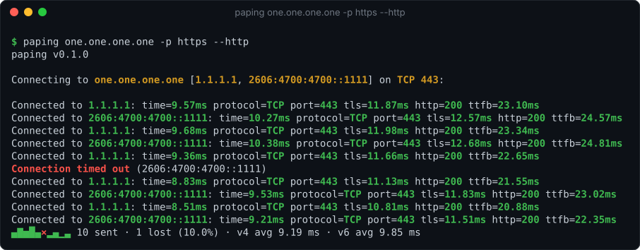
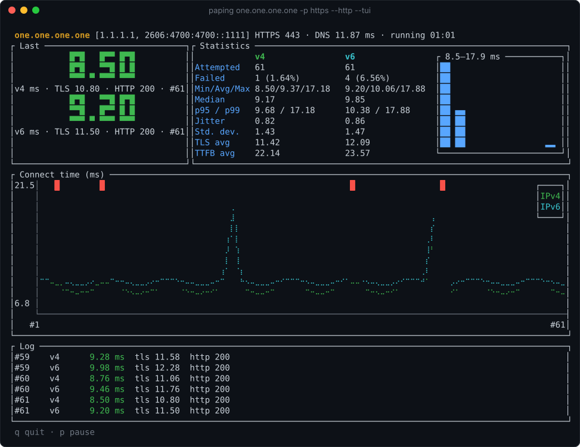

<h1 align="center">paping</h1>

<p align="center">
  <b>TCP port ping, modernized.</b><br>
  Connect times, TLS handshakes and HTTP answers for any host and port, over IPv4 and IPv6 side by side.
</p>

<p align="center">
  <a href="https://github.com/Ariazonaa/paping/actions/workflows/ci.yml"></a>
  <a href="https://github.com/Ariazonaa/paping/releases"></a>
  <a href="https://crates.io/crates/paping"></a>
  <a href="LICENSE"></a>
</p>

<p align="center">
  
</p>

paping connects to a host and port over and over and shows how long each connect takes,
the way `ping` does for ICMP. It works where ICMP is blocked, and it tells you whether a
*service* answers, not just a host.

This is a from-scratch rewrite in Rust of the classic paping 1.5.5. Your existing commands
keep working: the original flags behave as before, and for a single address the text
output matches line for line.

## Features

- **IPv4 and IPv6 side by side.** A name with both kinds of addresses is checked over both
  on one clock, with statistics per address. A broken IPv6 path shows up at once.
- **More than a connect.** `--tls` times the TLS handshake. `--http` sends a request and
  shows the status code and the time to the first byte; 5xx counts as a failure.
- **Made for terminals.** It adds colors by latency, a live status line with a sparkline,
  a trend in the statistics, and `--tui`, a full-screen live view.
- **Made for scripts.** It offers `--json` (NDJSON) and `--csv` output, with p95/p99 per
  address and clear exit codes. Pipes never get terminal extras.
- **A drop-in replacement for paping 1.5.5**, with its bugs fixed: a closed port now reads
  `Connection refused`, and the average no longer counts failures.
- **One small binary** for Windows, Linux and macOS (x64 and ARM64), with no runtime needed.

## Install

- **GitHub Releases:** download the archive for your platform from
  [Releases](https://github.com/Ariazonaa/paping/releases) and put `paping` on your `PATH`.
- **Cargo:** `cargo install paping`
- **winget:** `winget install Ariazonaa.paping` (once the package is accepted)

## Examples

Is the port open? The classic syntax still works:

```sh
paping example.com -p 443 -c 4
paping example.com:443 -c 4         # the same, port in the destination
paping db.internal -p postgres      # service names work too
```

Does the web service really answer? Check it every 5 seconds against a health endpoint:

```sh
paping example.com -p https --http --http-path /health --interval 5000
```

Compare IPv4 and IPv6, or stick to one:

```sh
paping example.com -p https          # both families, one line each per round
paping example.com -p https -4       # IPv4 only, like paping 1.5.5
```

Watch it live:

```sh
paping example.com -p https --http --tui
```

<p align="center">
  
</p>

Feed monitoring or a script:

```sh
# one summary per address after 10 rounds
paping example.com -p https -c 10 --json | jq -c 'select(.type == "summary") | {ip, loss_pct, avg_ms, p95_ms}'

# fail a CI step when the service is not reachable
paping staging.example.com -p https --http -c 3 || echo "staging is down"
```

## Options

```
paping [options] destination
```

`destination` is a host name, an IPv4 address or an IPv6 address, optionally with a port:
`example.com:443`, `[2001:db8::1]:22`. A bare IPv6 address (`2001:db8::1`) never contains a
port. The port can also be a service name: `http`, `https`, `ssh`, `ftp`, `smtp`, `dns`,
`imap`, `imaps`, `pop3`, `pop3s`, `submission`, `rdp`, `mysql`, `postgres`, `redis`.

### Original options

| Option | Meaning |
|---|---|
| `-p, --port N` | TCP port or service name (required unless the destination has one) |
| `-t, --timeout N` | timeout per step in ms (default 1000) |
| `-c, --count N` | number of rounds; without it, or with 0 or less, until Ctrl+C |
| `--nocolor` | no colors |
| `--ip-bind ADDR` | source address to connect from; it also picks IPv4 or IPv6 for the destination |
| `-?, --help` | usage |

### Extended options

| Option | Meaning |
|---|---|
| `-4`, `-6` | use only IPv4 / IPv6 addresses |
| `--interval N` | time between the starts of two rounds in ms (default 1000) |
| `--tls` | do a TLS handshake after each connect and show its time (`tls=4.21ms`) |
| `--http` | send `GET /` and show the status and the time to the first byte (`http=200 ttfb=23.45ms`) |
| `--http-path P` | path for `--http` (default `/`) |
| `--details` | show the DNS lookup time, median, jitter, standard deviation, and TLS/HTTP times |
| `--json` | NDJSON output |
| `--csv` | CSV output |
| `--tui` | live full-screen view; `p` pauses, `q` quits |
| `-V, --version` | version |

- `--tls` measures the handshake only: it does not check the certificate. Host names are
  sent as SNI, IP addresses are not.
- `--http` on port 443 uses HTTPS automatically; on other ports add `--tls` for HTTPS. Any
  answer below 500 counts as success (the service answers); 5xx counts as a failure. Only
  the status line is read, never the body.
- `-c` counts rounds: with two address families, `-c 4` makes 8 attempts.
- Colors turn off by themselves when the output is not a terminal or `NO_COLOR` is set.
- On Windows, timeouts above 65.5 s are capped at 65.5 s per connect.

## Output for scripts

`--json` prints one JSON object per line: a `start` line, one `probe` line per attempt, and
one `summary` line per address.

```json
{"type":"start","version":"0.1.0","destination":"example.com","ip":"93.184.215.14","ips":["93.184.215.14"],"port":443,"protocol":"TCP","tls":true,"dns_ms":12.34}
{"type":"probe","seq":1,"ip":"93.184.215.14","time":"2026-10-26T19:00:00.123Z","ok":true,"connect_ms":13.39,"tls_ms":11.2,"http_status":200,"ttfb_ms":23.45,"error":null}
{"type":"probe","seq":2,"ip":"93.184.215.14","time":"2026-10-26T19:00:01.123Z","ok":false,"connect_ms":null,"tls_ms":null,"http_status":null,"ttfb_ms":null,"error":"timeout"}
{"type":"summary","ip":"93.184.215.14","attempted":2,"connected":1,"failed":1,"loss_pct":50.0,"min_ms":13.39,"max_ms":13.39,"avg_ms":13.39,"median_ms":13.39,"p95_ms":13.39,"p99_ms":13.39,"jitter_ms":0.0,"stddev_ms":0.0,"tls_avg_ms":11.2,"ttfb_avg_ms":23.45}
```

- `error` is one of `timeout`, `refused`, `net_unreachable`, `host_unreachable`, `tls`,
  `http`, `http_status`, `other`. For `tls`, `http`, `http_status` and `other` there is
  also `error_detail` (for `http_status` it is the status code).
- If the host cannot be resolved, the only line is
  `{"type":"error","error":"resolve","message":"Cannot resolve host"}`.
- `null` means "does not apply", e.g. the averages when nothing connected.

`--csv` prints a header and one row per attempt:

```
seq,time,ip,port,ok,connect_ms,tls_ms,error,http_status,ttfb_ms
1,2026-10-26T19:00:00.123Z,93.184.215.14,443,true,13.390,11.200,,200,23.450
```

### Exit codes

| Code | Meaning |
|---|---|
| 0 | every attempt connected (also after Ctrl+C) |
| 1 | at least one attempt failed, in any address family |
| 2 | usage error, or the host cannot be resolved |

## Differences from paping 1.5.5

- 1.5.5 only spoke IPv4. This paping checks the first IPv4 and the first IPv6 address of a name
  side by side, with one statistics block per address. A server that only listens on
  `127.0.0.1` therefore shows `Connection refused` for `localhost`'s `::1`, and the exit code
  is 1. Use `-4` for the old behaviour. With `--ip-bind`, the source address decides the
  family.
- A closed port now reports `Connection refused`. 1.5.5 reported it as a timeout or even as a
  successful connection. Unreachable networks and hosts get their own messages.
- `Average` is the mean of the successful attempts. 1.5.5 divided by all attempts, so every
  failure lowered it.
- The header shows the name you typed and its addresses. 1.5.5 showed the canonical (CNAME)
  name.
- The banner reads `paping v0.1.0` without the copyright line.
- Invalid numbers such as `-p abc` are a usage error. 1.5.5 read them as 0.
- Usage errors and unresolvable hosts exit with code 2.
- On Windows, each attempt sends exactly one SYN, so a closed port is reported at once
  instead of after Windows' internal retries (about 2 s).

## Building from source

```sh
git clone https://github.com/Ariazonaa/paping
cd paping
cargo build --release        # target/release/paping
cargo test
```

The README images are rendered from paping's own output code with
`cargo run --example screenshots`.

## Responsible use

paping opens ordinary TCP connections, one per address and round, and, with `--tls` or
`--http`, a normal TLS handshake or one GET request. Only probe hosts and services you own
or are allowed to test, and keep the interval reasonable for systems you do not run
yourself.

## Privacy

paping has no telemetry and collects no data. It only connects to the destination you
name, after one DNS lookup through your system's resolver. Nothing is stored; results go
to your terminal or wherever you redirect them.

## Disclaimer

paping is provided "as is", without warranty of any kind, as stated in the
[MIT license](LICENSE). Its numbers are measurements from your machine at that moment;
use them as a diagnostic aid, not as proof of a service level.

## Credits

Inspired by and compatible with [paping](https://code.google.com/archive/p/paping/) 1.5.5 by
Mike Lovell (MIT). This is a from-scratch rewrite that contains no code from the original;
its options, usage text and output lines are reproduced for compatibility, see
[NOTICE](NOTICE).

## License

paping is licensed under the [MIT license](LICENSE).

The release binaries include Rust crates under their own licenses, mostly MIT, Apache-2.0
and ISC. Their texts are in [THIRD-PARTY-LICENSES.txt](THIRD-PARTY-LICENSES.txt) and in
every release archive; regenerate the file with
`python3 scripts/third-party-licenses.py > THIRD-PARTY-LICENSES.txt`.
